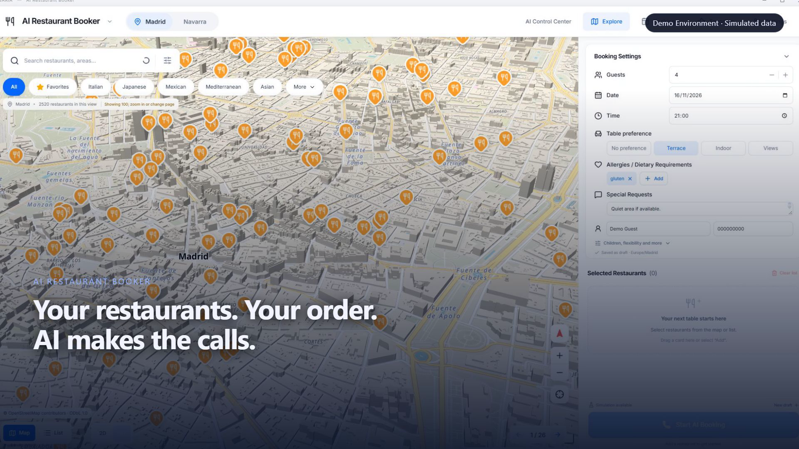
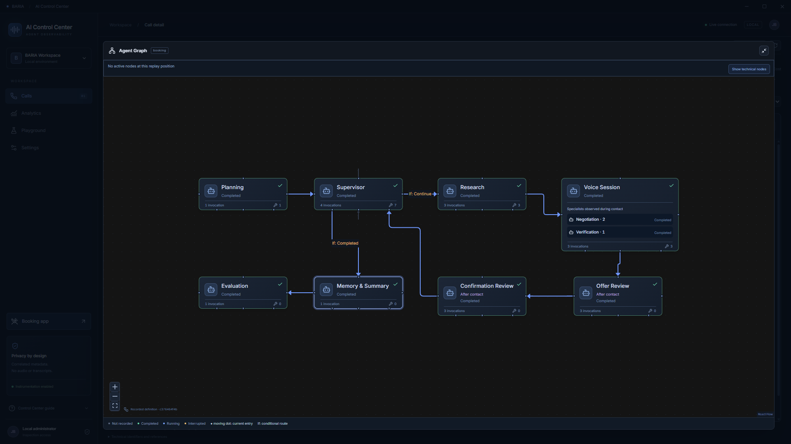
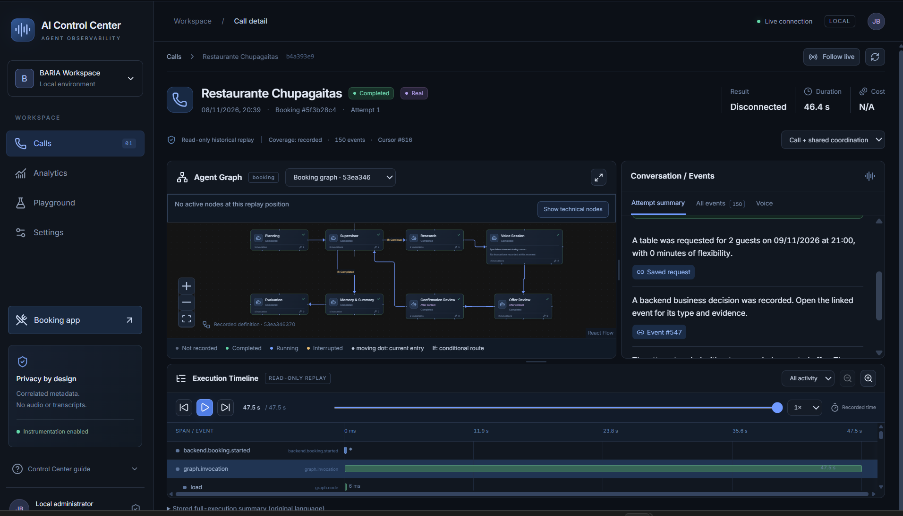
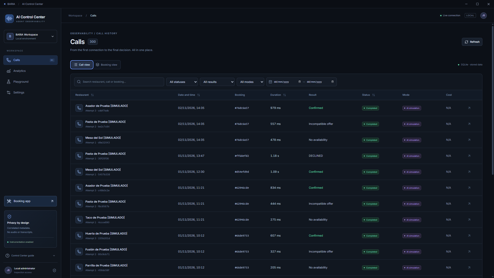
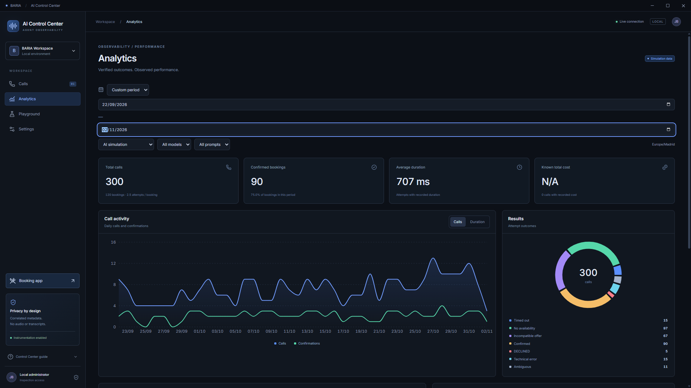
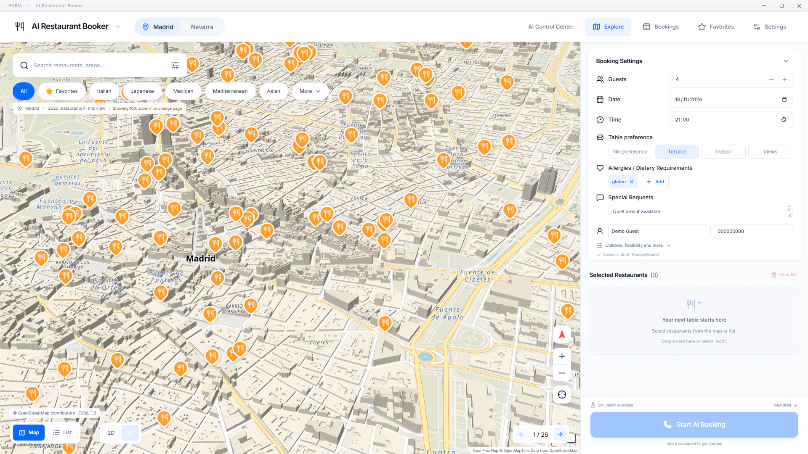
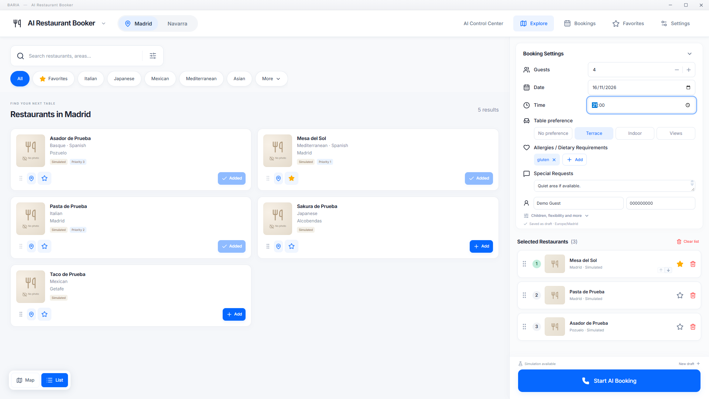
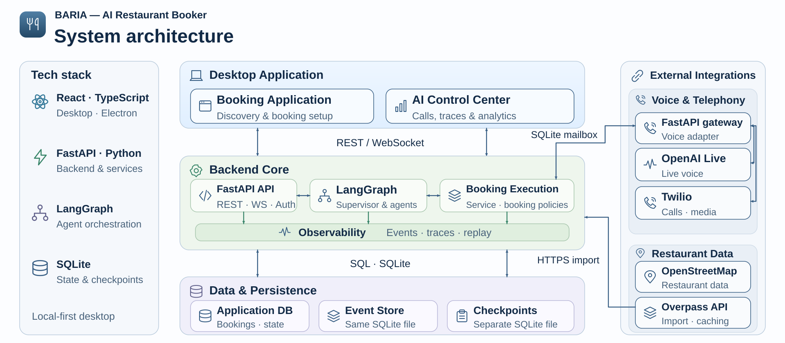
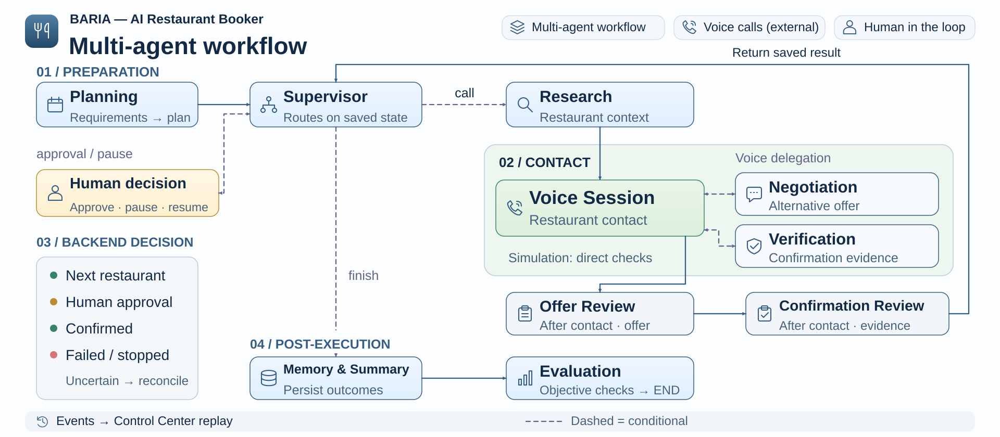

# BARIA — AI Restaurant Booker

**Your restaurants. Your order. AI makes the calls.**

Finding a table can mean calling several restaurants, repeating the same details,
and weighing alternatives against your plans. BARIA brings that workflow into a
desktop application: choose restaurants, put them in priority order, and supply
your reservation requirements. The backend coordinates contact, evaluates offers,
checks confirmation evidence and records the outcome.

Beyond booking automation, BARIA includes a dedicated **AI Control Center**
that provides detailed visibility into multi-agent executions, including agent
workflows, individual outputs, tool calls, execution timelines and historical
analysis.

The application includes a ready-to-run simulation and configurable OpenAI
voice and Twilio telephony integrations. Real phone calls require explicit
operator configuration and authorization.

## Product Demo

<a href="docs/media/ai-restaurant-booker-demo.mp4?raw=true" title="Watch the BARIA product demo — 3:15">
  
</a>

**[▶ Watch the full product demo](docs/media/ai-restaurant-booker-demo.mp4?raw=true)** ·
1080p · 3:15 · English narration and subtitles ·
[SRT](docs/media/ai-restaurant-booker-demo.en.srt) / [WebVTT](docs/media/ai-restaurant-booker-demo.en.vtt)

The thumbnail is a frame from the final video at 00:17. The demo combines recorded
simulations with clearly disclosed illustrative voice interactions; it does not
present real customer phone calls.

## AI Control Center — Multi-Agent Observability

BARIA goes beyond automating restaurant bookings by making the multi-agent
execution process transparent and inspectable. The **AI Control Center** is a
dedicated observability interface that connects agent activity with the recorded
events, tool results and backend decisions of each booking attempt. It helps
explain **which agents participated, what they did, when they acted and how the
outcome was reached**.

- **Interactive agent workflow:** explore the agents involved in an execution,
  their interactions and the path followed throughout the booking process.
- **Agent inspector:** examine individual agent outputs, tool calls, tool
  results and associated backend decisions.
- **Execution timeline:** follow events chronologically, including execution
  timing, with synchronized graph, timeline and event selection.
- **Call history and historical replay:** inspect earlier executions from
  persisted events. Replay reconstructs recorded activity; it **does not rerun
  agents or place new calls**.
- **Analytics:** review aggregated execution records and booking outcomes to
  understand system behavior across available runs.
- **Deterministic Playground:** run controlled simulation scenarios to inspect
  workflows without contacting real restaurants.

These capabilities make agent behavior easier to trace, debug and evaluate
without presenting a simulated booking as a verified real-world reservation.

Screenshots below show the actual Electron application using simulated data.

| Agent graph and inspector | Execution timeline |
| --- | --- |
|  |  |

| Call history | Analytics |
| --- | --- |
|  |  |

Open the Control Center from the booking application. With the backend already
running, it can also be launched independently:

```powershell
powershell -NoProfile -ExecutionPolicy Bypass -File scripts/start-app.ps1 -Admin
```

Administrative access uses a distinct token and bridge. See the
[observability data model](backend/OBSERVABILITY_DATA_MODEL.md) and
[replay design](backend/REPLAY_DESIGN.md) for implementation details.

## Booking Application

Choose restaurants on an interactive map, set reservation requirements, and
prioritize which venues to contact. The backend coordinates the booking workflow
and records outcomes subject to explicit policies and confirmation checks.

The screenshots show the actual Electron application using simulated data.

| Restaurant explorer | Reservation configuration |
| --- | --- |
|  |  |

## System Architecture

The desktop connects through typed Electron bridges to the local FastAPI backend.
The backend owns booking state and coordinates orchestration, persistence,
observability and external integrations.



## Multi-Agent Workflow

Planning prepares requirements; Supervisor routes work using persisted state.
Research supplies restaurant context. Voice handles contact and can delegate
specialist checks. Post-contact offer and confirmation reviews remain distinct
from checks within a live conversation. The backend decides authoritative results;
Memory & Summary and Evaluation complete the execution record.



Editable sources and approved PNG previews: [architecture documentation](docs/architecture/README.md).

## Key Features

- **Restaurant discovery:** interactive MapLibre map and list, Madrid/Navarra,
  cuisine filters, search, favorites and optional public catalog imports.
- **Priority-based booking:** drag restaurants into an ordered queue, save drafts,
  configure dates, guests, flexibility, seating and dietary requirements.
- **Controlled AI workflow:** LangGraph orchestration, specialized agents,
  versioned prompts, scoped tools and durable SQLite checkpoints.
- **Negotiation and verification:** mandatory constraints, explicit user approval
  for financial conditions, evidence-based confirmation and uncertainty handling.
- **Voice and telephony:** GPT-Live audio with specialist delegation and a separate
  Twilio Media Streams gateway, guarded by authorization, allowlists and budgets.
- **AI Control Center:** call/booking history, agent graphs, contextual inspector,
  synchronized event timeline, replay, analytics and deterministic Playground.
- **Local persistence:** independent selection, favorites, drafts and history;
  transactional queue updates with optimistic concurrency.

## Technology Stack

| Layer         | Technologies                                           | Role                                                  |
| ------------- | ------------------------------------------------------ | ----------------------------------------------------- |
| Desktop       | Electron, React, TypeScript, Vite                      | Booking application and isolated administrator window |
| UI            | MapLibre, React Flow, Lucide, Recharts, TanStack Query | Discovery, agent graph, charts and server state       |
| API           | Python, FastAPI, Pydantic v2                           | Validated REST/WebSocket contracts                    |
| Persistence   | SQLAlchemy 2, SQLite, Alembic                          | Transactions, migrations, events and checkpoints      |
| Orchestration | LangGraph, scoped tools, versioned prompts             | Agent coordination and resumable execution            |
| Providers     | OpenAI Responses/GPT-Live, Twilio                      | Optional extraction, audio and outbound telephony     |
| Validation    | pytest, Ruff, Vitest, Playwright/Electron              | Policy, protocol, persistence and UI checks           |
| Video         | Remotion                                               | Reproducible source for the approved product demo     |

## Quick Start

Windows 11: install **Node.js 24 LTS** and **uv**, then clone or extract this repository.

1. Double-click **`Instalar.cmd`** once. It installs dependencies, provisions
   Python 3.14 if needed, prepares the database and builds the desktop.
2. Double-click **`Iniciar BARIA.cmd`** whenever you want to use BARIA. It starts
   the backend, waits until it is ready, and opens the application.

Close all BARIA windows to stop the backend started by the launcher. Keep its
console open while using the application. An occupied port produces a clear
error; the launcher never stops an existing backend.

Setup creates a fresh database and private local credentials. Use the supplied
simulated restaurants to make a demo booking immediately. No OpenAI or Twilio
account is needed. [Full installation guide](INSTALLATION.md).

## OpenAI & Twilio Configuration

The backend uses `backend/.env`; safe defaults are in
[backend/.env.example](backend/.env.example). Simulation, LangGraph simulation,
voice sandbox and real telephony are separate operation modes. Paid voice and
phone calls are disabled by default. Tokens stay in Electron Main/backend.
See [CONFIGURATION.md](CONFIGURATION.md) for every supported setting.

Use your own OpenAI project key and model access for Responses extraction or
GPT-Live voice. Outbound telephony additionally requires your Twilio account,
eligible phone number, public HTTPS/WSS gateway, permitted own-number destinations,
tariffs and explicit per-run authorization.

The code and offline integration tests are included. Follow
[REAL_CALL_READINESS.md](REAL_CALL_READINESS.md) for account setup, endpoints,
signature validation and manual provider acceptance.

## Testing & Evaluation

### Automated Checks

```powershell
powershell -NoProfile -ExecutionPolicy Bypass -File scripts/test.ps1
```

Tests use temporary SQLite databases and simulated/mocked providers. They do not
contact restaurants or paid APIs. [Executed release results](TEST_REPORT.md),
[AI evaluation procedures](backend/AI_TESTING.md),
[administrative test coverage](backend/ADMIN_TESTING.md).

### Project Structure

```text
backend/           API, contracts, migrations, agents, providers and tests
frontend/          React renderer, Electron Main/preloads and UI tests
scripts/           Relative-path Windows setup, startup and validation
video/             Remotion source, captured demo footage and narration
docs/architecture/ Approved SVGs, previews and editable sources
docs/media/        Approved MP4 and subtitle sidecars
docs/screenshots/  Curated actual application captures
docs/licenses/     Locked dependency license inventory and notices
```

### Documentation

- [Installation](INSTALLATION.md) · [Configuration](CONFIGURATION.md)
- [Real-call setup and readiness](REAL_CALL_READINESS.md)
- [Frontend REST/WebSocket API](backend/docs/frontend-api.md) · [Admin API](backend/ADMIN_API.md)
- [AI architecture](backend/AI_ARCHITECTURE.md) · [Agents and tools](backend/AGENTS_AND_TOOLS.md)
- [Observability data model](backend/OBSERVABILITY_DATA_MODEL.md) · [Replay design](backend/REPLAY_DESIGN.md)
- [Test report](TEST_REPORT.md) · [Packaging report](PACKAGING_REPORT.md)
- [Third-party notices and asset provenance](THIRD_PARTY_NOTICES.md)
- [Security and release audit](SECURITY.md) · [Publication guide](PUBLISHING.md)

### Security

Keep generated credentials, local databases and Electron profiles out of Git.
The business API stays on loopback; only the separately authenticated voice
gateway should be publicly exposed. See [SECURITY.md](SECURITY.md) for audit
results and the documented dependency risks.

### Known Limitations

- Restaurant catalog coverage depends on the source; photos and live availability
  are never inferred from OpenStreetMap records.
- External audio/telephone acceptance requires the operator's configured accounts
  and authorized own-number testing; mocked tests are not real calls.
- Use one local executor per SQLite database. Packaged standalone installer
  distribution is separate from this source release.

### License

Original BARIA source is licensed under [Apache License 2.0](LICENSE), authorized
by the project owner. Third-party dependencies, fonts, map data and Remotion
retain their own terms; see [NOTICE](NOTICE) and
[THIRD_PARTY_NOTICES.md](THIRD_PARTY_NOTICES.md).
