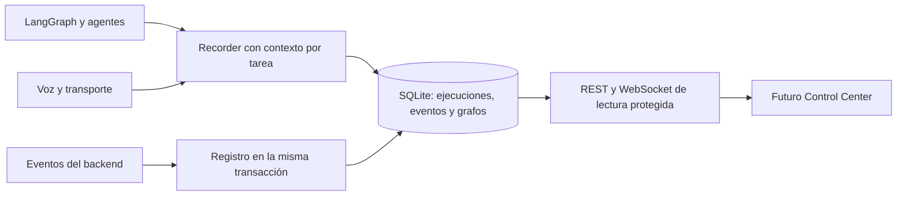

# Preparación del AI Control Center

El backend compartido conserva la instrumentación existente. La interfaz Electron, Analytics y Playground están implementados en [AI Control Center](../frontend/docs/control-center.md). Las reservas siguen siendo propiedad de `BookingExecutionService`; la observabilidad registra hechos y no toma decisiones.

`app/observability/` contiene modelos, contratos Pydantic, recorder, instrumentación de nodos, consultas y rutas. Se conservan `AgentTrace`, `ToolOperation`, `AIExecution`, `CallAttempt`, `VoiceCallSession`, eventos de reserva y checkpoints existentes. `ObservedExecution` es un índice de captura y procedencia para los distintos modos; no sustituye los estados de negocio.

Las filas nuevas se crean a partir de ejecuciones observadas. La simulación clásica registra eventos del backend y no aparenta haber ejecutado LangGraph. La simulación AI añade agentes, herramientas y grafo reales, con respuestas simuladas. Sandbox y telefonía registran metadatos del transporte utilizado. Modelo configurado y modelo reportado por el proveedor son campos distintos; los agentes basados en reglas no se etiquetan como invocaciones LLM.

El contexto usa `ContextVar`, con restauración al salir de cada span. Las tareas asíncronas heredan el contexto al crearse. API y gateway correlacionan mediante intento, sesión de llamada y ejecución; `parent_span_id` permanece nulo cuando no se conoce un padre real entre procesos.

Los fallos de escritura de telemetría fuera de la transacción de negocio no convierten una llamada ya iniciada en un nuevo intento. Se registra un código fijo en consola y, si el almacenamiento vuelve a estar disponible, un evento `telemetry.gap` y un contador persistente. Una caída antes de recuperar la escritura puede dejar información incompleta; no se inventa su desenlace.

La migración `0004` añade tres tablas y sus índices. No reconstruye las tablas de reservas. Las rutas de lectura usan un token administrativo independiente. SQLite y checkpoints son archivos locales sin cifrado añadido por esta entrega; su protección en disco depende de los permisos, copias y ubicación del perfil del sistema operativo. No se publican servicios nuevos.

Detalles: [modelo de datos](OBSERVABILITY_DATA_MODEL.md), [eventos](TRACE_SCHEMA.md), [API](ADMIN_API.md), [replay](REPLAY_DESIGN.md) y [pruebas](ADMIN_TESTING.md).
