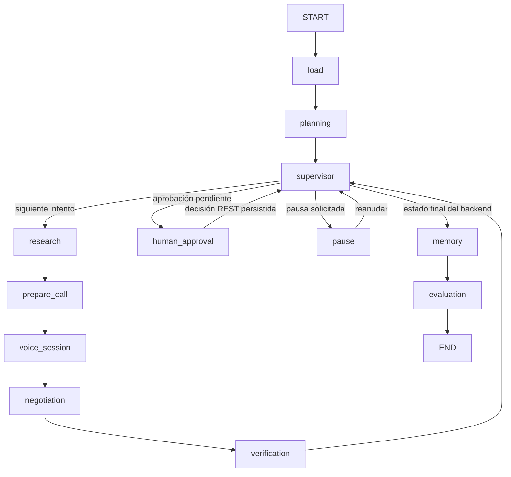

# Arquitectura de IA

La migración `0004` y `app/observability/` incorporan eventos persistentes correlacionados, spans padre-hijo, definición histórica del grafo compilado y lectura administrativa independiente. El registro de negocio se captura en su transacción; los wrappers observan las invocaciones sin cambiar las rutas del grafo. Arquitectura y límites en [ADMIN_ARCHITECTURE.md](ADMIN_ARCHITECTURE.md).

Se ha conservado el backend existente y su suite original. Los cambios del motor añaden ejecución de **un intento** (`step`), selección de proveedor por modo y verificación estructurada; no hay un segundo motor de reservas. La migración `0002` añade ejecuciones AI, trazas, operaciones idempotentes, memorias y sesiones telefónicas. La referencia de confirmación pasa a ser opcional: una reserva real puede carecer de localizador, pero sigue requiriendo evidencia explícita.

## Tres niveles y propiedad

| Nivel | Componentes | Responsabilidad |
|---|---|---|
| Negocio | `BookingExecutionService`, `NegotiationPolicyService`, `ReservationVerificationService` | Prioridad, intentos, aprobaciones, estados y confirmaciones |
| Orquestación | `AIRuntime`, `AgentTools`, agentes tipados, LangGraph | Planificar, delegar, pausar, observar y resumir |
| Voz | `LiveSession`, `VoiceDelegationService`, `TwilioCallProvider`, gateway | Conversación independiente, audio, transporte y propuestas/evidencia |

Los agentes no reciben SQL, credenciales ni un método para fijar `CONFIRMED`. El extractor interpreta habla; las políticas deterministas vuelven a validar personas, fecha, hora, mesa, presupuesto, requisitos, identidad y nombre. El motor exige además una confirmación explícita, ligada al intento y a la oferta aceptada. La voz publica propuestas y evidencia en un buzón persistido; únicamente el motor autoriza la aceptación y registra el resultado.

## Grafo ejecutable

`voice_session` invoca la herramienta que permite al motor avanzar un intento. Dentro de ese intento, el adaptador extrae propuestas y el Verification Agent organiza evidencia **antes** de que el motor confirme. Los nodos de negociación y verificación del grafo principal conservan los resultados tipados y observan lo persistido; no duplican transiciones. Supervisor elige rutas condicionales a partir del estado actual de SQLite. La sesión de voz no se ejecuta de nuevo por cada paquete de audio.

El grafo tiene límite de pasos y la cola, límite de restaurantes. Los reintentos de herramientas mutantes usan un ID estable y un hash de parámetros. Una operación iniciada sin resultado conocido requiere reconciliación; no se repite a ciegas.

## Persistencia y reanudación

LangGraph utiliza `AsyncSqliteSaver` en `<DATABASE_FILE>.ai-checkpoints.sqlite`, separado del esquema Alembic. Cada invocación usa `durability="sync"` y `thread_id=AIExecution.id`. `booking_id` permanece como referencia al negocio. El estado guarda plan, IDs y resultados estructurados; no copia el teléfono ni conversaciones completas.

Las dos bases no forman una transacción distribuida. El registro `ToolOperation` permite reconocer efectos ya completados y evita repetir operaciones inciertas si el proceso cae entre efecto y checkpoint. Los eventos de negocio se guardan en la misma transacción que su cambio. La sesión pública y la aplicación local comparten la base de negocio, sin compartir memoria RAM.

`interrupt()` conserva una pausa o aprobación. `Command(resume=...)` solo despierta el grafo: aprobar o rechazar sigue pasando por `POST /bookings/{id}/decisions`, con versión y validación del estado real. Una reanudación no equivale a aprobar un depósito.

Tras reiniciar, los intentos que pudieron estar activos pasan a `FAILED/INTERRUPTED` y no se rellaman. Las pausas sin intento ni transporte activo se conservan y pueden reanudarse. Las aprobaciones persistidas sobreviven, pero una aprobación telefónica tiene una caducidad corta; al vencer, se detiene la ejecución y se solicita el cierre de la llamada. Los checkpoints de estados finales se reconcilian hacia los nodos de resumen/evaluación, sin nuevos efectos externos.

## Modos y modelos

- `simulation`: proveedor mock previo, comportamiento compatible con el backend original.
- `ai_simulation`: LangGraph completo, agentes deterministas y fixtures por defecto; cero costes. `AI_EXTRACTION_MODE=responses` habilita opcionalmente extracción mediante Responses y requiere una clave.
- Voice sandbox: conversación de audio con GPT-Live sin telefonía ni cambios en reservas; activación independiente y consentimiento por conexión.
- `real_telephony`: adaptador Twilio y gateway aislado. Desactivado por defecto y limitado a números propios autorizados.

Los nombres se configuran únicamente en Settings: `REASONING_MODEL` (por defecto `gpt-6-luna`), `VOICE_MODEL` (`gpt-live-1`) y `VOICE_NAME` (`marin`). Las pruebas offline no invocan esos modelos. No se ha verificado acceso a los modelos en una cuenta real porque no hay credenciales configuradas.

La base de esta implementación es un [StateGraph real](https://docs.langchain.com/oss/python/langgraph/overview), con [checkpoints persistentes](https://docs.langchain.com/oss/python/langgraph/persistence) e [interrupciones reanudables](https://docs.langchain.com/oss/python/langgraph/interrupts). Para procedimientos y alcance comprobado, consultar [AI_TESTING.md](AI_TESTING.md).
